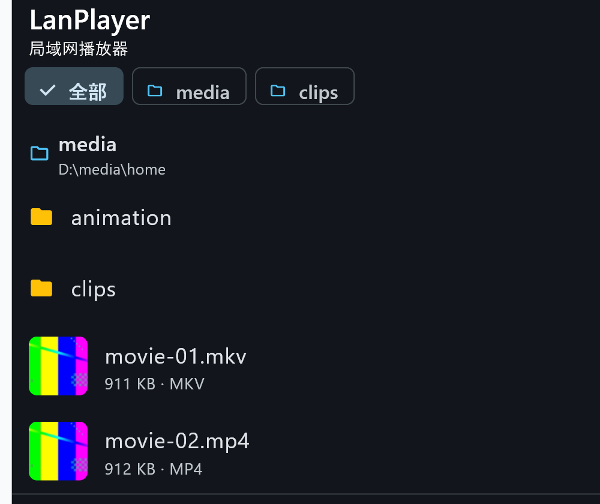
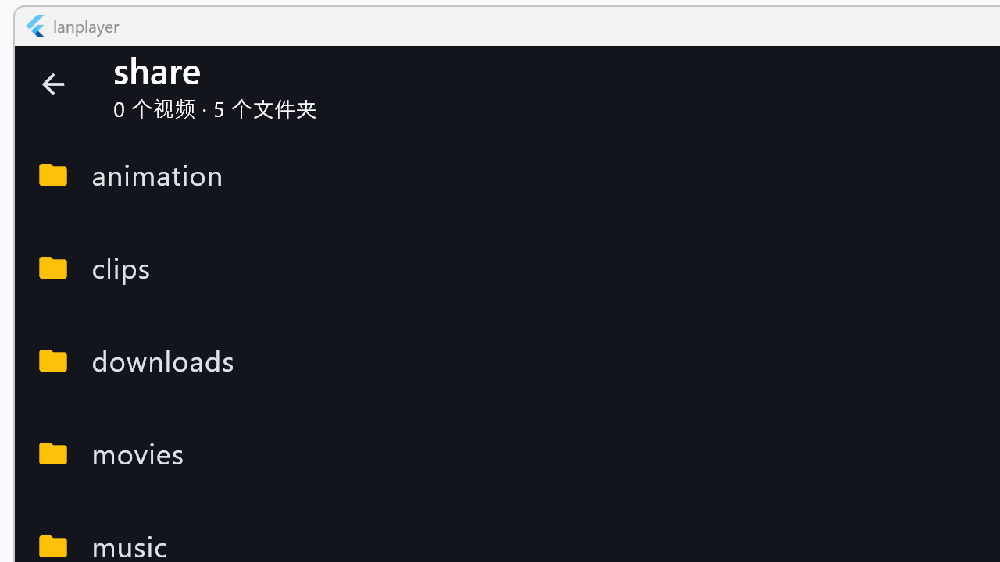
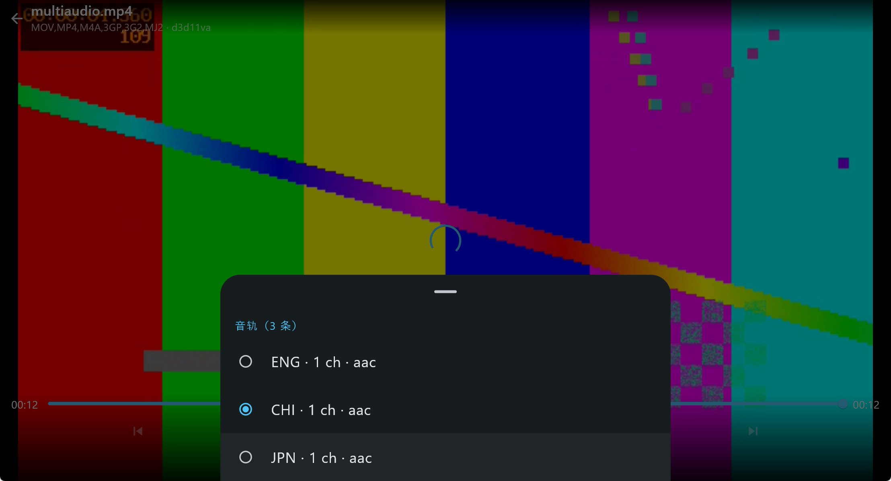
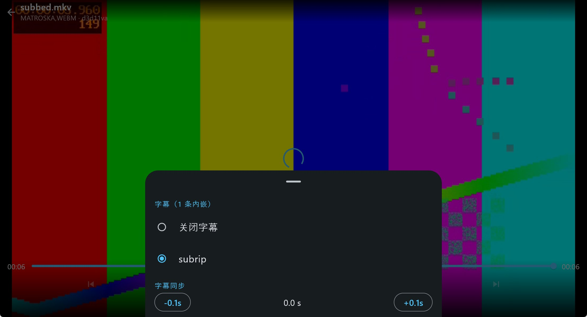
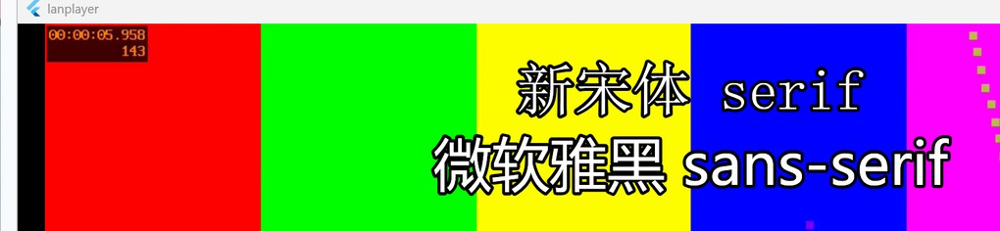
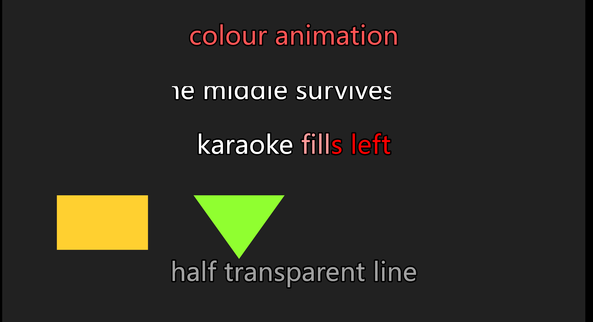
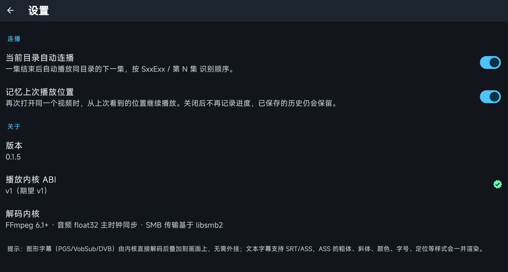
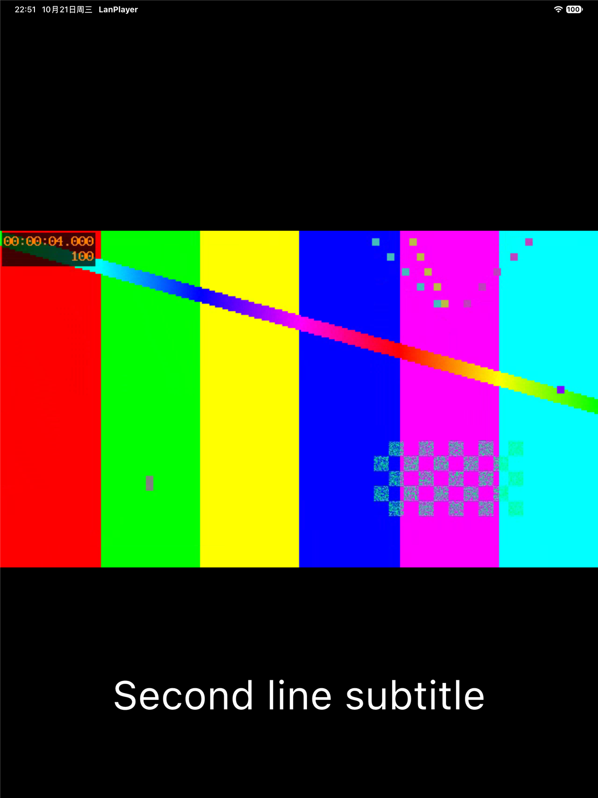

# LanPlayer · A LAN video player

English | [简体中文](README.md)

A player that opens videos straight off an SMB share. The UI is Flutter (Windows /
macOS / Android / iOS / iPadOS); underneath is a playback core written in C11 on top
of FFmpeg, reached through `dart:ffi` with no layer in between.



## What it is for

The usual home setup is "one machine stores the films, everything else watches them".
Most players either only open local files, or lean on DLNA transcoding on a TV box,
or mount the share as a network drive where dragging the seek bar means waiting half
a minute. LanPlayer does one thing: **it plays a file on a share as if it were
local** — hardware decoding, subtitles, a seek bar that responds, and the next
episode queued automatically.

What it does not do: no server, no transcoding, no download cache, and no share
enumeration. Sharing comes from the operating system; the app only asks for an
address, a share name, a user and a password.

## Features

| | |
|-|-|
| **Sources** | SMB shares (read-only), any drive file or folder on the local machine |
| **Containers / codecs** | Whatever FFmpeg supports: MKV / MP4 / AVI / MOV / TS / FLV / WebM, H.264 / HEVC / VP9 / AV1, and more |
| **Hardware decoding** | D3D11VA on Windows, VideoToolbox on macOS / iOS, MediaCodec on Android, falling back to software automatically |
| **Picture path** | Desktop hands the frames to a Flutter external texture (shared D3D11 on Windows, IOSurface on macOS); mobile hands the rectangle to a native platform view (SurfaceView on Android, AVSampleBufferDisplayLayer on iOS). See "Platform status" |
| **Audio** | WASAPI on Windows, AudioQueue on Apple, AAudio on Android; AAC / MP3 / FLAC / Vorbis / Opus and more |
| **Subtitles** | Embedded tracks plus external SRT / ASS / SSA / VTT; ASS styling (colour, outline, size, font, positioning, animation, clipping, vector drawing, karaoke); PGS / VobSub / DVB bitmap subtitles |
| **Track selection** | Separate audio and subtitle panels listing every track in the file, with default pick by preferred / fallback language |
| **Playback control** | Play-pause, ±10 s, seek by dragging, 0.5x–2.0x pitch-preserving speed, volume 0–100 (gain to 200 %), click-to-mute, full screen |
| **Continuous play** | The current directory is ordered by `SxxEzz` or "episode N" and the next one starts on its own |
| **Resume** | Reopening a file continues where it stopped; the list shows a progress bar and percentage |
| **Browsing** | First-frame thumbnails, cached on disk, generated on demand; only videos and subtitles are listed, `.txt` / `.docx` and friends stay hidden, subtitles sit under their video |
| **Launch** | On mobile a logo animation covers the first frame for about 1.2 s while the store loads run behind it, then the list appears; the desktop opens straight into it |
| **Also** | LAN scan (concurrent probing of the local subnet), desktop keyboard shortcuts and touch gestures, light/dark following the system |
| **Settings** | Toggles for continuous play and resume, preferred / fallback languages; About shows the current version, core ABI and decoder info |

## Screens

| Home | Browsing a share |
|-|-|
|  |  |

| Audio tracks | Subtitles |
|-|-|
|  |  |

Both `Fontname` and the inline `\fn` override in ASS subtitles really take effect, so
two fonts can be mixed inside one subtitle:



The advanced tags render too: `\t` colour animation, `\clip` cropping, `\p` vector
drawing and `\k` karaoke fill:



A logo animation covers the first frame while the store loads run in parallel:


Settings → About shows the running version:



On mobile the same UI is used (a native platform view plus subtitle bubbles):



## Getting started

### From an installer

Download the file for your platform from
[Releases](https://github.com/LXinH3RT/LanPlayer/releases):

| Platform | File | Installation |
|-|-|-|
| Windows 10+ | `LanPlayer-<version>-windows-x64-setup.exe` | Double-click; installs per-user, no UAC prompt |
| macOS (Apple Silicon) | `LanPlayer-<version>-macos-arm64.dmg` | Drag into Applications |
| Android 8+ (arm64) | `LanPlayer-<version>-android-arm64.apk` | Allow unknown sources, then install |

The Windows package is not code-signed, so SmartScreen offers "Run anyway"; the macOS
package is ad-hoc signed, so the first launch needs approval under
"System Settings → Privacy & Security".

### Prepare a share

The operating system's own file sharing is enough; the app needs no server component:

```powershell
# Example: share D:\Movies as "Movies", read-only for the account "lanplay"
New-SmbShare -Name Movies -Path D:\Movies -ReadAccess lanplay
```

### Add a source

`Add → SMB server`, then fill in **address / share name / user name / password`. The
share name is the one typed into the "Sharing" tab of the folder's properties; the app
does not enumerate the server's shares because that service is disabled by default on
some systems. If the address is unknown, "Scan the LAN" probes the SMB port across the
local subnet concurrently and lists the hosts that answer — tapping one fills the
address in.

`Add → Add local file/folder` browses any drive on this machine level by level and
takes either a folder or a single video file. Picking a file puts that one file on the
home screen as its own source, and tapping it plays it.

Once a source exists the home screen opens its root directory directly — no extra tap.
With several sources they are listed side by side, a row of buttons at the top narrows
the view to one of them, and "All" in each block header opens the full browser.

### Play

Tap a video and it plays. A subtitle file next to it with the same stem
(`S01E01.zh-CN.srt` and so on) is loaded automatically. In the player you can switch
audio tracks and subtitles, shift subtitle timing and change speed.

Desktop shortcuts: `Space` play-pause, `←` / `→` ±10 s, `↑` / `↓` volume, `M` mute,
`Enter` full screen, `C` / `Z` speed up and down, `X` back to 1.0x, `,` / `/` subtitle
earlier and later, `.` clear the subtitle offset, `Tab` decode stats, `Esc` leave full
screen (otherwise go back), `Backspace` go up one level in the browser. Every binding
can be changed under `Settings → Shortcuts`, which also lists all mouse gestures. The
volume button in the bottom bar shows the current level; tap it to mute, long-press for
the volume panel.

## Building

The repository holds sources only. Dependencies (FFmpeg, libsmb2, toolchains) are
fetched into `.tools/` by `tool/fetch_deps.py`; build output lands in directories
covered by `.gitignore`.

### Windows

```powershell
python tool\fetch_deps.py

# Core (needs Zig, not Visual Studio)
python scripts\build_windows.py
build\win-x64\lp_smoke_test.exe

# Desktop app (needs the "Desktop development with C++" workload)
python scripts\build_windows_desktop.py --core
# -> app\windows\out\build\x64-VisualStudio182026\runner\Release\lanplayer.exe

# Installer
python tool\fetch_deps.py nsis
python scripts\build_windows_installer.py
# -> dist\LanPlayer-<version>-windows-x64-setup.exe
```

### macOS / iOS

```bash
# Dependencies and core
SLICES=macosx python3 scripts/build_apple_deps.py

# App
cd app && flutter pub get && flutter build macos --release
flutter build ios --release --no-codesign

# Device
TEAM_ID=<your 10-character team id> python3 scripts/ios_device_install.py

# dmg
python3 scripts/build_macos_dmg.py
```

**Rerun `build_apple_deps.py` after touching `native/src/**`.** `flutter build macos` and
`flutter build ios` do not compile the C core; they only link
`native/third_party/lanplayer/apple/<family>/lib/liblanplayer.a` into the host. Skip the
rebuild and the app builds fine but runs the previous core, which looks exactly like
"my change did nothing". `scripts/build_apple_deps.py` compares source and archive
mtimes on its way out, `tool/check_all.py` asserts the same thing, and the quickest way
to confirm the archive really changed is `strings <liblanplayer.a> | grep <a string you
just added>`.

### Android

```bash
ANDROID_NDK_HOME=~/android-ndk-r26 python3 scripts/build_android_deps.py
python3 scripts/build_android_apk.py
```

### Self-check

```powershell
# Static checks, dart compile, dart tests, installer and release assertions
.\.tools\python\python.exe tool\check_all.py
```

`tool/check_all.py` includes a group of assertions that pin the picture path down: four
hosts must answer the same `lanplayer/video` method names, the platform view's `viewType`
must be byte-identical on the Dart and native sides, and mobile must answer
`createTexture` with `platformView: true`. The iOS platform view must also install and
remove the core's frame callback under its own lock — the core has exactly one callback
slot, so a remove and a pointer change outside the same critical section shows up as
"the picture freezes for good after switching screens while audio keeps playing".

On Windows `flutter analyze` / `flutter test` fail because `%APPDATA%\.flutter_tool_state`
is not writable. Use the wrapper, which redirects `TMP` / `TEMP` / `APPDATA` /
`LOCALAPPDATA` / `PUB_CACHE` into the repository's `.tools/`:

```bash
python scripts/run_flutter_tests.py            # = flutter test
python scripts/run_flutter_tests.py analyze    # = flutter analyze
```

Per-platform pitfalls and the error lookup table are in [docs/build.md](docs/build.md).

## Platform status

| | Windows | macOS | Android | iOS / iPadOS |
|-|-|-|-|-|
| UI | ✅ | ✅ | ✅ | ✅ |
| SMB browsing | ✅ | ✅ | ✅ | ✅ |
| Hardware decoding | ✅ D3D11VA | ✅ VideoToolbox | ✅ MediaCodec | ✅ VideoToolbox |
| Audio output | ✅ WASAPI | ✅ AudioQueue | ✅ AAudio | ✅ AudioQueue |
| Picture path | External texture (shared D3D11) | External texture (IOSurface) | Platform view (SurfaceView) | Platform view (AVSampleBufferDisplayLayer) |
| Installer | ✅ exe | ✅ dmg | ✅ apk | Sign it yourself |

Why two picture paths: the Flutter engine has one limitation worth knowing — as long as
an external texture is active it repaints the whole layer tree on every vsync, no matter
how many frames the video itself has. Desktop is not exposed to that (the engine pulls
frames on the core's notification, thirty times a second for 30 fps content, and the
texture is zero-copy), so mobile hands the rectangle to a native view instead: decoded
frames go straight into `SurfaceView` / `AVSampleBufferDisplayLayer` and reach the screen
through the system compositor, never through Flutter's rasteriser. The trade-off is that
the mobile picture no longer takes part in Flutter's transforms and clips — the scale and
letterbox rectangle is computed on the Dart side (`fittedSize` in
`app/lib/ui/widgets/video_surface.dart`) and handed to the native view, which lays itself
out in real pixels. That layout directly drives memory: laying the native view out inside
a virtual box makes the system allocate a graphics buffer larger than the screen.

The Windows desktop build decodes and presents on the GPU: D3D11VA frames are
converted by the video processor and published as a D3D11 shared texture that
Flutter samples directly, so no frame is copied back to system memory; audio runs
on WASAPI shared mode and falls back to waveOut when the device cannot be opened.

## Verified

| Item | Result |
|-|-|
| C core / libsmb2 / FFmpeg linkage | ✅ 14 core files plus 48 libsmb2 files built with Zig on Windows, 0 errors |
| Video with audio | ✅ H.264 software decode, AAC → float stereo, position advances correctly |
| Hardware decoding | ✅ D3D11VA (within 0.2 levels of the software reference), VideoToolbox and MediaCodec all confirmed on devices |
| 10-bit sources | ✅ Wide-colour H.264 / HEVC fall back to software decoding where hardware decoding is unreliable, so progress without a picture no longer happens |
| Subtitles | ✅ Embedded plus external SRT/ASS/VTT, code-page fallback for non-UTF-8 files, ASS styling (including inline `\fn`, `\t`, `\clip`, `\p` and `\k`), bitmap subtitles |
| SMB browsing / credential check / LAN scan | ✅ Read-only, share name typed by hand, no enumeration |
| List thumbnails | ✅ First frame only, `LPT2` header on disk, requested for video rows only |
| Folders full of FLV no longer hang | ✅ Three core defects plus one concurrency overload fixed |
| Media-only browsing | ✅ `.txt` / `.docx` / `.DS_Store` hidden, subtitles grouped under their video |
| Default audio / subtitle track | ✅ Picked by preferred / fallback language, audio and subtitle panels separate |
| Volume | ✅ 0–200 % slider applied in the core through `lp_ring_set_gain` on the ring buffer |
| Upgrade in place | ✅ Installing a new version over a running one works; the installer asks the old copy to quit first |
| Mobile platform views | ✅ Android SurfaceView and iOS AVSampleBufferDisplayLayer both played a 20 s clip to the end on devices, timecode and frame numbers advancing; the Android graphics buffer is now 2133×1200 (was 5777×3250) |
| Frame pacing | ✅ A 24 fps source drops 0 frames on both macOS and iPad, worst frame gap 46–75 ms (macOS) / 43–49 ms (iPad) against a 41.67 ms frame period |
| Dart tests | ✅ 361 cases pass, `flutter analyze` reports no issues |
| Installers on three platforms | ✅ Windows, macOS and Android all install and play on real hardware |
| iPad on device | ✅ Signed and installed; SMB browsing, VideoToolbox decoding and playback position all verified |

## Known limitations

* ASS `\t` animation is interpolated linearly or with the `accel` curve; `\fade` inside `\t` and shape animations beyond `\clip` are not supported, and `\move` is still a static `\pos`.
* The server's share list is not enumerated; the share name has to be typed.
* No AC3 / DTS passthrough to a receiver; HDR is decoded and shown as-is, without tone
  mapping, and the mobile platform views do not tag the frame with colour-space metadata.
* One video at a time (the player screen is a singleton).
* The mobile picture is a native view: rotation works (the parent scene transform carries
  the whole subtree), but arbitrary Flutter effects such as opacity or a non-rectangular
  clip will not reach it.

The full list and the plan are in [docs/roadmap.md](docs/roadmap.md).

## Layout

```
LanPlayer/
├─ app/                     Flutter app (Windows / macOS / Android / iOS)
│  ├─ lib/core/             FFI bindings, player controller
│  ├─ lib/data/             Models, stores, media repository, LAN scan, thumbnail cache, track preferences
│  ├─ lib/player/           Playlist and episode ordering
│  ├─ lib/ui/               Screens, subtitle overlay, thumbnail tile, volume and track sheets
│  └─ test/                 361 cases
├─ packages/
│  ├─ lanplayer_video/      Picture path: the channel contract shared by four hosts (Dart), plus the Windows texture plugin (C++)
│  └─ lanplayer_core/       iOS / macOS FFI plugin (links the static library into Runner)
├─ native/                  C11 playback core
│  ├─ include/lanplayer/    Public ABI (the only contract dart:ffi sees, 41 exported functions)
│  ├─ src/core/             Demux, decode, sync, subtitles, thumbnails, control
│  ├─ src/source/           LpSource: SMB / local / custom AVIO
│  ├─ src/platform/         android / apple / win32 / stub
│  └─ tests/                Dependency-free test executables
├─ scripts/                 Per-platform builds, screenshots, installers, upgrade and uninstall checks
├─ tool/                    Static checks, dependency fetch, test media generation
└─ docs/                    Architecture, build, protocol, security, roadmap
```

## Conventions

* Scripts are Python only (`python scripts/xxx.py`), UTF-8 encoded. Build, capture and
  verification scripts share `tool/lpscript.py` (processes, paths, environment
  redirection) and `tool/lpwin.py` / `tool/lpimage.py` (windows, bitmaps).
  `tool/check_all.py` guards encoding and a set of static invariants.
* C sources are UTF-8 without a BOM and end with a newline.
* Generated files never enter the repository: `build/`, `dist/`, `.tools/`,
  `app/build/`, `app/windows/out/`, `native/third_party/`.
* Docs, scripts, comments and screenshots carry no real environment: addresses look
  like `192.168.1.10`, accounts are `share`, devices are named by platform only. Media
  and screenshots come from files generated by `scripts/make_doc_media.py`; no stills
  from real films. See [docs/security.md](docs/security.md).

## Documentation

* [Architecture and threading](docs/architecture.md)
* [Build guide](docs/build.md)
* [Media sources and protocol extension](docs/media-source.md)
* [Security boundaries](docs/security.md)
* [Roadmap and known limitations](docs/roadmap.md)

## Licence

The code here is original to this project. FFmpeg (LGPL-2.1+, must be linked
dynamically with its terms observed) and libsmb2 (MIT) are external dependencies,
compiled and distributed by whoever builds the app.

The UI font is [MiSans](https://hyperos.mi.com/font/), redistributed under the
Apache License 2.0. The bundled file is the variable font `MiSansVF.ttf`, shipped
without subsetting or modification. The licence asks for both the licence text
and the notice to travel with any redistribution, and both live in the repo:

* `app/assets/fonts/MiSans-LICENSE.txt` — the full Apache License 2.0 text
* `app/assets/fonts/NOTICE.txt` — where the font came from, what it is used for,
  and that it was not modified

The full third-party list is in [LICENSE](LICENSE).
