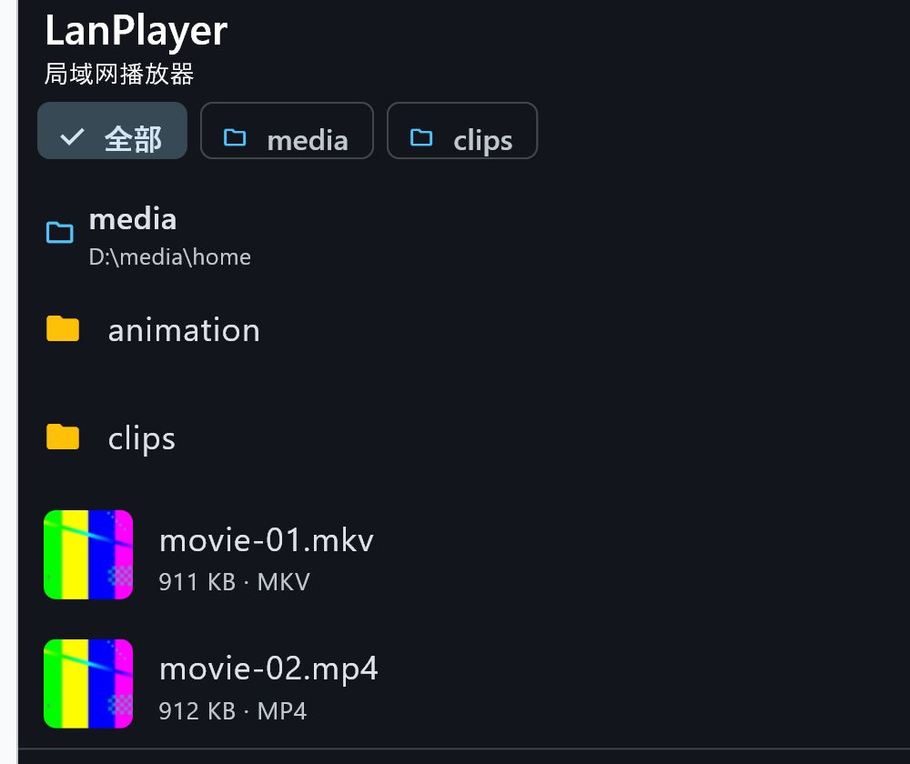
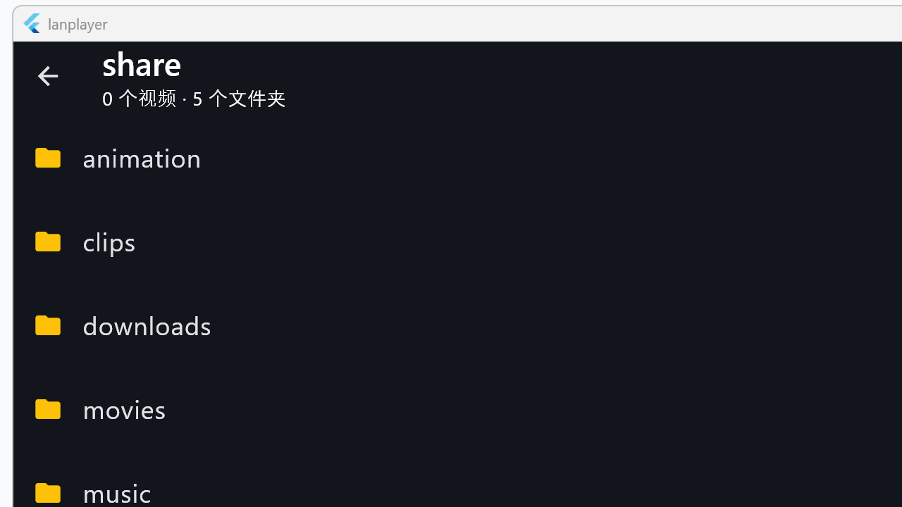
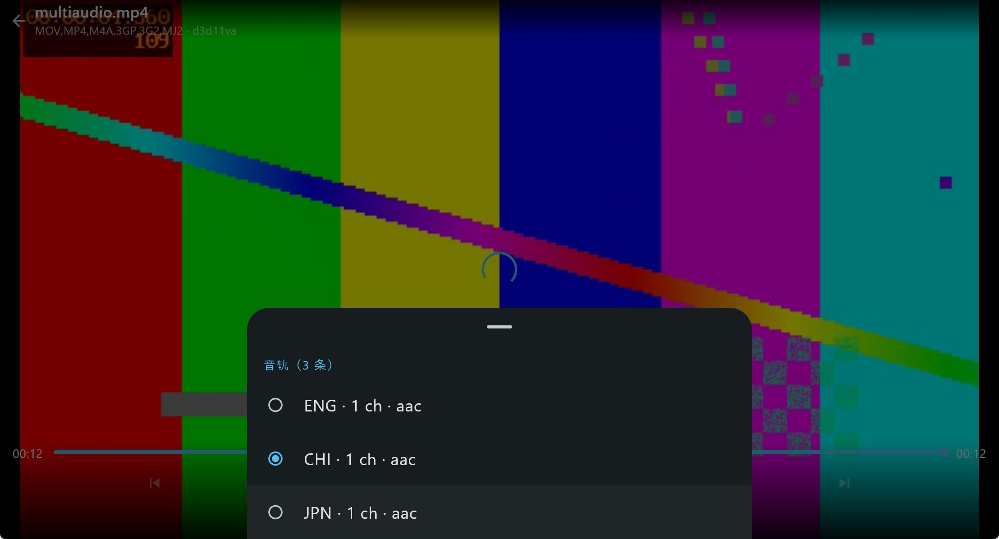
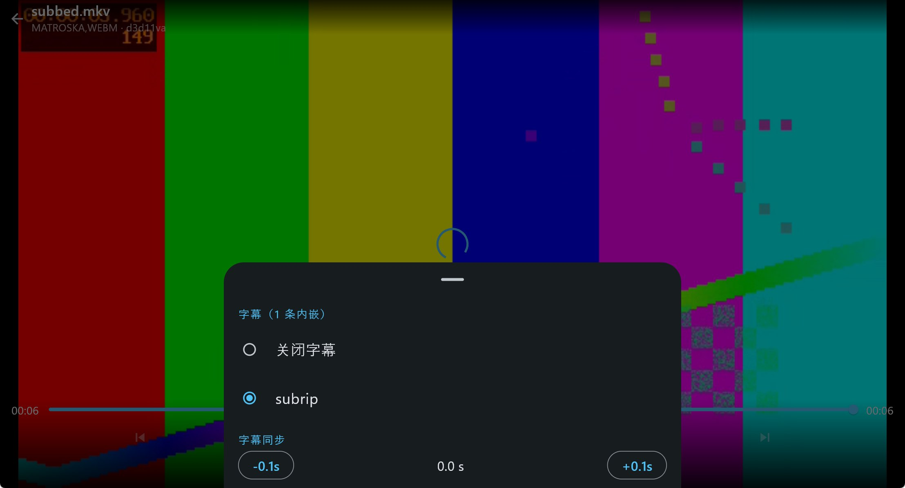
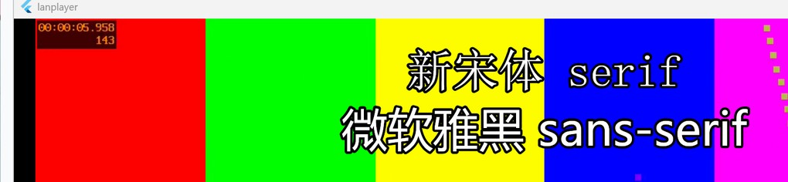
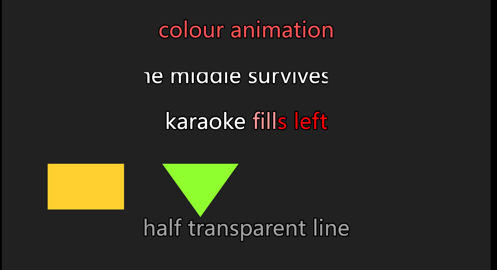
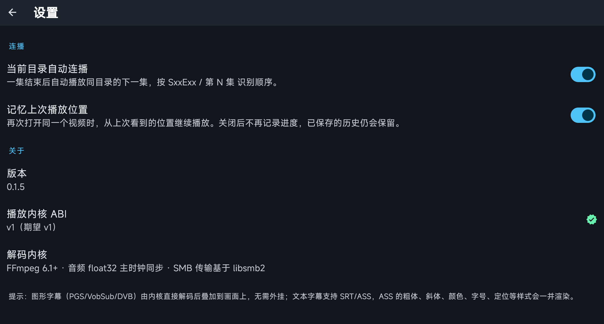
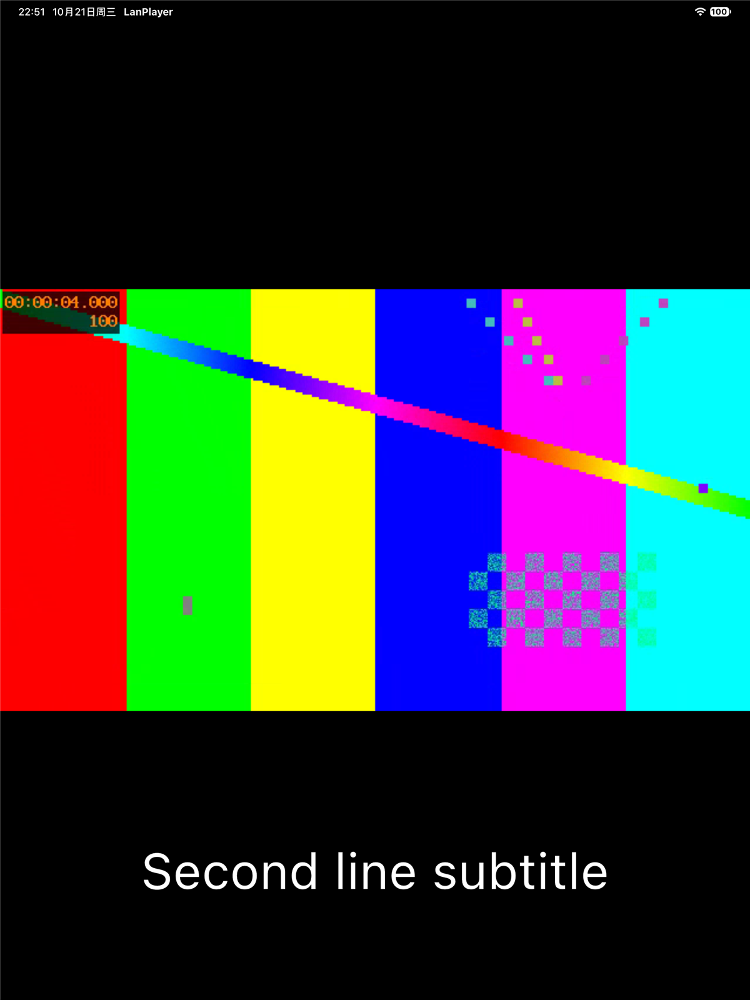

# LanPlayer · 局域网播放器

[English](README.en.md) | 简体中文

一个把 SMB 共享里的视频直接放出来的播放器：Flutter 写一套界面（Windows / macOS /
Android / iOS / iPadOS），底下是一个用 C11 和 FFmpeg 写的播放内核，通过 `dart:ffi`
直连，没有中间层。



## 它解决什么

家用网络里最常见的形态是「一台机器存片，其它设备看」。现成的播放器要么只能放本地文件，
要么在电视盒子上依赖 DLNA 转码，要么把 SMB 当成网盘挂载、拖动进度条要等几十秒。
LanPlayer 只做一件事：**把共享里的文件当成本地文件播**——硬解、带字幕、进度条能拖、
放完自动接下一集。

它不做的：不做服务端、不做转码、不做下载缓存、不枚举服务器上的共享名。共享由系统自带的
文件共享提供，App 只负责填地址、共享名、账号、密码。

## 功能

| | |
|-|-|
| **来源** | SMB 共享（只读）、本机任意盘符下的文件或文件夹 |
| **容器 / 编码** | 由 FFmpeg 决定：MKV / MP4 / AVI / MOV / TS / FLV / WebM 等，H.264 / HEVC / VP9 / AV1 等 |
| **硬解** | Windows D3D11VA、macOS / iOS VideoToolbox、Android MediaCodec，失败自动回退软件解码 |
| **画面通道** | 桌面端交 Flutter 外部纹理（Windows 共享 D3D11、macOS IOSurface），移动端交原生平台视图（Android SurfaceView、iOS AVSampleBufferDisplayLayer），详见「平台状态」 |
| **音频** | Windows WASAPI、Apple AudioQueue、Android AAudio；AAC / MP3 / FLAC / Vorbis / Opus 等 |
| **字幕** | 内嵌轨 + 外挂 SRT / ASS / SSA / VTT；ASS 富文本（颜色、描边、字号、字体、定位、动画、裁剪、矢量绘图、卡拉 OK）；PGS / VobSub / DVB 图形字幕 |
| **选轨** | 音轨与字幕各自成面板，可列出文件内全部轨道并切换；按首选 / 次选语言自动挑默认轨 |
| **播放控制** | 播放暂停、±10 秒、进度拖拽、0.5x–2.0x 变速不变调、音量滑杆（增益 0–200%）、点一下静音、全屏 |
| **连播** | 当前目录按 `SxxEzz` / 第 N 集 识别顺序自动接下一集 |
| **记忆进度** | 重开同一文件从上次位置续播，列表上显示进度条与百分比 |
| **浏览** | 缩略图取首帧、本地缓存、按需生成；只列视频与字幕，`.txt` / `.docx` 之类不显示，字幕归到对应视频下面 |
| **启动** | 移动端先显示图标动画（约 1.2 秒）再进内容，读配置与首屏拉列表在动画期间就在跑；桌面端直接进列表 |
| **其它** | 局域网扫描（并发探测本机网段）、桌面键盘快捷键与触屏手势、界面配色可选黑 / 白 / 跟随系统 |
| **设置** | 解码、画面、外观、音频、字幕、播放、快捷键、关于八页；连播与记忆进度的开关、首选 / 次选语言；「关于」里显示当前版本号、内核 ABI 与解码器信息 |

## 界面

| 首页 | 浏览共享 |
|-|-|
|  |  |

| 音轨面板 | 字幕面板 |
|-|-|
|  |  |

ASS 字幕里的 `Fontname` 与行内 `\fn` 都会真正生效，同一条字幕里可以混排两种字体：



进阶标签也照常渲染：`\t` 颜色动画、`\clip` 裁剪、`\p` 矢量绘图、`\k` 逐字染色：



启动时先显示图标动画，配置读取与首屏列表请求在动画期间并行进行：


「设置 → 关于」里能直接看到当前版本号：



移动端是同一套界面（原生平台视图 + 字幕气泡）：



## 快速开始

### 用安装包

从 [Releases](https://github.com/LXinH3RT/LanPlayer/releases) 下载对应平台的文件：

| 平台 | 文件 | 安装方式 |
|-|-|-|
| Windows 10+ | `LanPlayer-<版本>-windows-x64-setup.exe` | 双击，装到当前用户目录，不弹 UAC |
| macOS (Apple Silicon) | `LanPlayer-<版本>-macos-arm64.dmg` | 拖进「应用程序」 |
| Android 8+ (arm64) | `LanPlayer-<版本>-android-arm64.apk` | 允许安装未知来源后安装 |

Windows 包没有代码签名，SmartScreen 会提示「仍要运行」；macOS 包是 ad-hoc 签名，
首次打开需在「系统设置 → 隐私与安全性」里放行。

### 准备一个共享

用系统自带的文件共享即可，App 不依赖任何服务端组件：

```powershell
# 举例：把 D:\Movies 共享成 Movies，给账号 lanplay 只读权限
New-SmbShare -Name Movies -Path D:\Movies -ReadAccess lanplay
```

### 添加来源

`添加 → SMB 服务器`，填 **地址 / 共享名 / 用户名 / 密码** 四项。
共享名是 Windows「属性 → 共享」里填的那个名字；App 不会去枚举服务器的共享列表，
因为那项服务在部分系统上默认关闭。不知道 IP 时可以点「扫描局域网」，它会并发探测本机
所在网段的 SMB 端口，把有响应的主机列出来，点一行自动填进地址框。

`添加 → 添加本地文件/文件夹` 可以逐层浏览本机任意盘符，选中一块目录或一个视频文件。
选文件时，这个文件会作为单独一条来源出现在首页，点开即播。

添加完首页就直接摊开每个来源的根目录，不用再点一次；有多个来源时它们并排列出，
顶部一排按钮可以只看其中一个，每块标题右边的「全部」进完整浏览页。

### 播放

点视频即播。默认自动加载同目录同名的字幕文件（`S01E01.zh-CN.srt` 之类），
播放页可切音轨、切字幕、调字幕延迟、切倍速。

桌面端快捷键：`空格` 播放暂停，`←` / `→` 前后 10 秒，
`↑` / `↓` 音量，`M` 静音，`Enter` 全屏，`C` / `Z` 加速与减速，`X` 回到 1.0 倍速，
`，` / `/` 字幕提前与延后，`。` 清空字幕偏移，`Tab` 显示解码统计，`Esc` 退出全屏（否则返回），
`Backspace` 返回上一级（浏览页）。
画面上单击是播放 / 暂停（桌面端）；手机上单击是把控制栏叫出来或收起来，
双击都是全屏切换。
键位都可以在 `设置 → 快捷键` 里改，那里同时列出全部鼠标手势。
底部音量按钮上直接显示当前音量，点它是静音，长按打开音量面板。

界面配色在 `设置 → 外观` 里选：黑色（默认）、白色，或者跟随系统。

手机与平板打开片子时默认锁横屏，退出播放页再把方向交还给系统；
平板横竖习惯不同，这一项可以在 `设置 → 播放` 里关掉。桌面端不锁方向。

横屏之后方向跟着机身走：把手机从左侧横放翻到右侧横放，画面立刻跟着翻过来，
不受系统「自动旋转」开关影响。

## 构建

仓库只含源码，依赖（FFmpeg、libsmb2、工具链）由 `tool/fetch_deps.py` 下载到 `.tools/`，
产物落在 `.gitignore` 覆盖的目录里。

### Windows

```powershell
python tool\fetch_deps.py

# 内核（用 Zig，不需要 Visual Studio）
python scripts\build_windows.py
build\win-x64\lp_smoke_test.exe

# 桌面端（需要 VS 的「使用 C++ 的桌面开发」工作负载）
python scripts\build_windows_desktop.py --core
# -> app\windows\out\build\x64-VisualStudio182026\runner\Release\lanplayer.exe

# 安装包
python tool\fetch_deps.py nsis
python scripts\build_windows_installer.py
# -> dist\LanPlayer-<版本>-windows-x64-setup.exe
```

### macOS / iOS

```bash
# 依赖与内核
SLICES=macosx python3 scripts/build_apple_deps.py

# app
cd app && flutter pub get && flutter build macos --release
flutter build ios --release --no-codesign

# 真机
TEAM_ID=<你的 10 位 Team ID> python3 scripts/ios_device_install.py

# dmg
python3 scripts/build_macos_dmg.py
```

**改过 `native/src/**` 之后必须重跑 `build_apple_deps.py`**。`flutter build macos` /
`flutter build ios` 不会编 C 内核，它们只把 `native/third_party/lanplayer/apple/<family>/lib/liblanplayer.a`
链接进宿主。忘了重编的话，构建成功、运行的是旧内核，症状是「代码明明改了却没生效」。
`scripts/build_apple_deps.py` 会在收尾时对比源码与归档的 mtime 并告警，`tool/check_all.py`
也有一条同义断言；确认归档真的换了，最快的办法是 `strings <liblanplayer.a> | grep <你刚加的字符串>`。

### Android

```bash
ANDROID_NDK_HOME=~/android-ndk-r26 python3 scripts/build_android_deps.py
python3 scripts/build_android_apk.py
```

### 自检

```powershell
# 静态检查 + dart 编译 + dart 用例 + 安装器与发布断言
.\.tools\python\python.exe tool\check_all.py
```

`tool/check_all.py` 里有一条把「画面通道」钉住的断言组：四份宿主必须认同一套
`lanplayer/video` 方法名，平台视图的 `viewType` 必须在 Dart 与原生两侧逐字相同，
移动端必须以 `platformView: true` 回复 `createTexture`。iOS 的平台视图还必须
在锁内装卸内核帧回调——内核只留一个回调槽位，装卸与指针变更不在同一临界区就会
出现「切换页面后画面永久停住但音频照常」。

`flutter analyze` / `flutter test` 在 Windows 上会因 `%APPDATA%\.flutter_tool_state`
不可写而失败，用包装脚本（把 `TMP` / `TEMP` / `APPDATA` / `LOCALAPPDATA` / `PUB_CACHE`
重定向进仓库内 `.tools/`）：

```bash
python scripts/run_flutter_tests.py            # = flutter test
python scripts/run_flutter_tests.py analyze    # = flutter analyze
```

各平台的坑与报错对照表见 [docs/build.md](docs/build.md)。

## 平台状态

| | Windows | macOS | Android | iOS / iPadOS |
|-|-|-|-|-|
| 界面 | ✅ | ✅ | ✅ | ✅ |
| SMB 浏览 | ✅ | ✅ | ✅ | ✅ |
| 硬解 | ✅ D3D11VA | ✅ VideoToolbox | ✅ MediaCodec | ✅ VideoToolbox |
| 音频输出 | ✅ WASAPI | ✅ AudioQueue | ✅ AAudio | ✅ AudioQueue |
| 画面通道 | 外部纹理（D3D11 共享） | 外部纹理（IOSurface） | 平台视图（SurfaceView） | 平台视图（AVSampleBufferDisplayLayer） |
| 安装包 | ✅ exe | ✅ dmg | ✅ apk | 需自行签名 |

画面通道为什么分两条：Flutter 引擎有一条限制——只要存在活跃的外部纹理，它就会在每个
vsync 上重绘整棵图层树，与视频本身是多少帧无关。桌面端不受这条约束（引擎按内核的通知
推帧，30 fps 的内容每秒只推 30 次，且纹理是零拷贝的），移动端则改由原生视图接管这块
矩形：解码出的帧直接进 `SurfaceView` / `AVSampleBufferDisplayLayer`，由系统合成器上屏，
不经过 Flutter 的光栅化管线。代价是移动端的画面不再参与 Flutter 的变换与裁剪，缩放与
黑边的矩形由 Dart 侧先算好（`app/lib/ui/widgets/video_surface.dart` 的 `fittedSize`），
再交给原生视图按真实像素尺寸布局——这一点直接影响显存占用：按虚拟尺寸布局会让系统分配
一块比屏幕还大的图形缓冲。

Windows 桌面端解码与出画都在 GPU 上：D3D11VA 解出的帧经视频处理器转成 BGRA，
写进 D3D11 共享纹理直接交给 Flutter 采样，不再回读系统内存；音频走 WASAPI
共享模式，设备打不开时自动退回 waveOut。

## 已验证

| 项 | 结论 |
|-|-|
| C 内核 / libsmb2 / FFmpeg 链接 | ✅ Windows 上 Zig 编 14 个源文件 + 48 个 libsmb2 文件，0 error |
| 视频 + 音频播放 | ✅ H.264 软解、AAC → float 立体声、位置推进正确 |
| 硬解 | ✅ D3D11VA（与软件参考均值差 ≤0.2 级）、VideoToolbox、MediaCodec 均真机跑通 |
| 10-bit 片源 | ✅ 宽色深 H.264 / HEVC 在硬解不稳的平台自动改走软件解码，不再出现「有进度没画面」 |
| 字幕 | ✅ 内嵌 + 外挂 SRT/ASS/VTT + 非 UTF-8 按代码页回退 + ASS 富文本（含行内 `\fn`、`\t`、`\clip`、`\p`、`\k`）+ 图形字幕 |
| SMB 浏览 / 凭据校验 / 局域网扫描 | ✅ 只读、共享名自填、不做枚举 |
| 列表缩略图 | ✅ 只解第一帧、`LPT2` 头落盘缓存、只对视频行请求 |
| 含 FLV 的文件夹不再卡死 | ✅ 修掉内核三处缺陷 + 一处并发过载 |
| 浏览列表只留媒体 | ✅ `.txt` / `.docx` / `.DS_Store` 等不显示，字幕归到对应视频 |
| 多音轨 / 多字幕默认轨 | ✅ 按首选 / 次选语言挑，音轨与字幕面板拆开 |
| 音量 | ✅ 设置里的「音量增益」按 0.1x–2.0x 起步（1.0x = 跟随系统音量），播放页滑杆 0–100 对应增益 0–2.0 且只影响本次播放；内核 `lp_ring_set_gain` 直接作用在环形缓冲上 |
| 覆盖升级 | ✅ 旧版在跑也能直接装新版，安装器会先请退旧进程 |
| 移动端平台视图 | ✅ Android SurfaceView 与 iOS AVSampleBufferDisplayLayer 均真机播完一段 20 秒短片，时间码与帧号连续推进；Android 图形缓冲 2133×1200（修前 5777×3250） |
| 送帧节拍 | ✅ 24 fps 片源在 macOS 与 iPad 上 `dropped` 均为 0，单帧最长间隔 46–75 ms（macOS）/ 43–49 ms（iPad），贴近 41.67 ms 的帧周期 |
| Dart 用例 | ✅ 361 个用例全过，`flutter analyze` 无 issue |
| 三端安装包 | ✅ Windows / macOS / Android 装到真机后均能播 |
| iPad 真机 | ✅ 签名装机、SMB 浏览、VideoToolbox 硬解出画、播放位置推进均实测 |

## 已知限制

* ASS 的 `\t` 动画按线性或 `accel` 曲线插值；`\t` 里的 `\fade` 与 `\clip` 之外的形状动画还不支持，`\move` 仍按 `\pos` 静态定位。
* 不枚举服务器共享名，共享名需手填。
* 不支持 AC3 / DTS 直通到功放；HDR 只解码直出，不做 tone mapping，移动端的平台视图也没有给帧打色彩空间元数据。
* 同时只播一个视频（播放页单例）。
* 移动端画面是原生视图：旋转能跟随（父级场景变换会带着整棵子树一起转），但透明度、非矩形裁剪这类 Flutter 效果作用不到它上面。

完整列表与版本计划见 [docs/roadmap.md](docs/roadmap.md)。

## 目录

```
LanPlayer/
├─ app/                     Flutter 应用（Windows / macOS / Android / iOS）
│  ├─ lib/core/             FFI 绑定、播放器控制器
│  ├─ lib/data/             模型、存储、媒体源仓库、局域网扫描、封面缓存、选轨偏好
│  ├─ lib/player/           播放列表与集数识别
│  ├─ lib/ui/               界面、字幕气泡、封面格、音量/音轨面板
│  └─ test/                 361 个用例
├─ packages/
│  ├─ lanplayer_video/      画面通道：四宿主共用的通道契约（Dart）+ Windows 纹理插件（C++）
│  └─ lanplayer_core/       iOS / macOS 的 FFI 插件（把静态库链进 Runner）
├─ native/                  C11 播放内核
│  ├─ include/lanplayer/    公共 ABI（dart:ffi 的唯一契约，41 个导出函数）
│  ├─ src/core/             解封装、解码、同步、字幕、封面、控制
│  ├─ src/source/           LpSource：SMB / 本地 / 自定义 AVIO
│  ├─ src/platform/         android / apple / win32 / stub
│  └─ tests/                无依赖的测试可执行文件
├─ scripts/                 各平台构建、截图、安装包与升级/卸载对照脚本
├─ tool/                    静态检查、依赖下载、测试素材生成
└─ docs/                    架构、构建、协议、安全、路线图
```

## 开发约定

* 脚本一律 Python（`python scripts/xxx.py`），UTF-8 编码；构建、截图与验证脚本共用
  `tool/lpscript.py`（进程、路径、环境重定向）、`tool/lpwin.py` / `tool/lpimage.py`
  （窗口、位图）。`tool/check_all.py` 有编码与静态断言护栏。
* C 源码 UTF-8 无 BOM、以换行结尾。
* 生成物一律不入库：`build/`、`dist/`、`.tools/`、`app/build/`、`app/windows/out/`、
  `native/third_party/`。
* 文档、脚本、注释与截图中不写真实环境：地址用 `192.168.1.10` 这类示例，账号用
  `share`，设备只写平台名；素材与截图用 `scripts/make_doc_media.py` 生成的合成文件，
  不贴真实影音画面。详见 [docs/security.md](docs/security.md)。

## 文档

* [架构与线程模型](docs/architecture.md)
* [构建指南](docs/build.md)
* [媒体源与协议扩展](docs/media-source.md)
* [安全边界](docs/security.md)
* [路线图与已知限制](docs/roadmap.md)

## 许可

代码为本项目原创；FFmpeg（LGPL-2.1+，需动态链接并遵守其条款）、libsmb2（MIT）作为
外部依赖由使用者自行编译与分发。

界面字体为 [MiSans](https://hyperos.mi.com/font/)，按 Apache License 2.0 随程序分发。
本程序打包的是可变字体 `MiSansVF.ttf`，未做子集化或改刻。许可证要求再分发时保留
许可证与声明，两者都在仓库里：

* `app/assets/fonts/MiSans-LICENSE.txt` —— Apache License 2.0 全文
* `app/assets/fonts/NOTICE.txt` —— 字体来源、用途与未修改声明

完整的第三方组件清单见 [LICENSE](LICENSE)。
