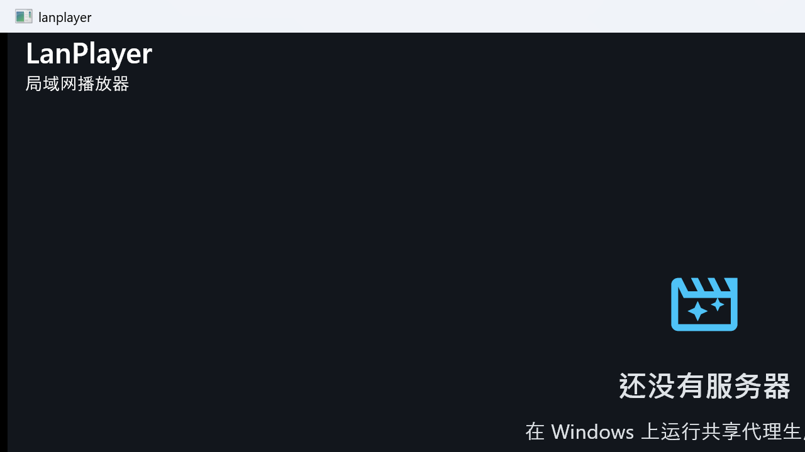
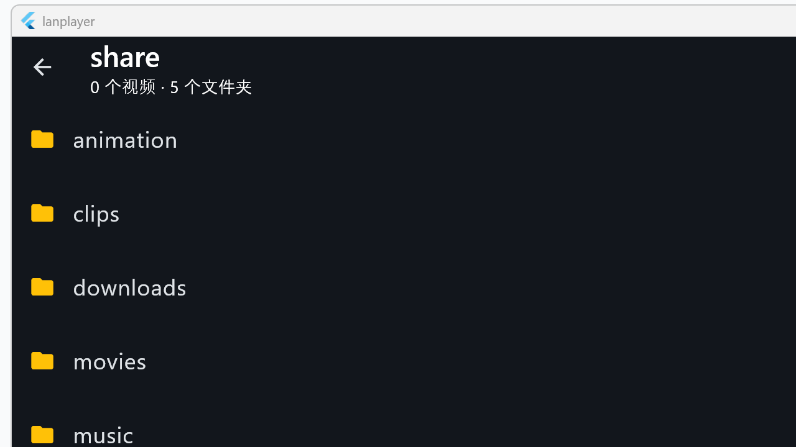
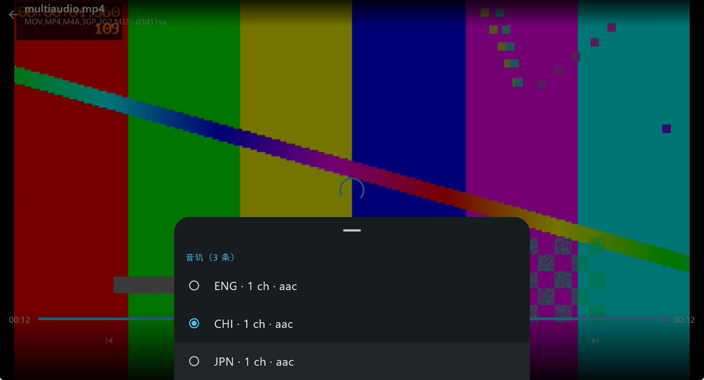
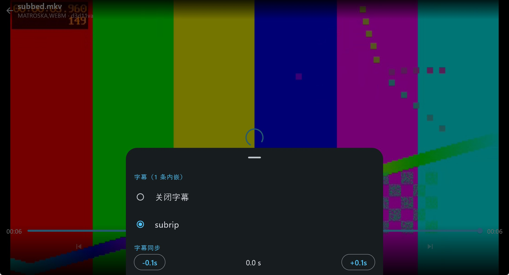
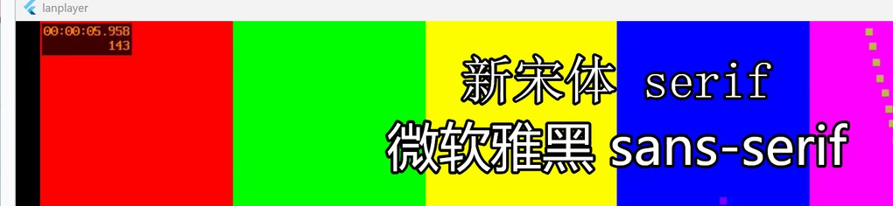

# LanPlayer · 局域网播放器

用 Flutter 一套 UI（Windows / macOS / Android / iOS / iPadOS）包一个 C11 + FFmpeg 的播放内核，
通过 `dart:ffi` 直连。目标只有一个：**把家里 SMB 共享里的视频，用硬解、带字幕、不卡顿地放出来**。

```
┌──────────────────────────── Flutter (Dart) ────────────────────────────┐
│  服务器列表 / 文件浏览器 / 播放页 / 解码设置                          │
│  PlayerController ── dart:ffi ──► liblanplayer.so / .a / .dll          │
│  字幕气泡（Flutter Text 渲染）        视频：Texture(textureId)          │
│  图形字幕（直接混合进 BGRA 帧）                                          │
└───────────────┬────────────────────────────────────────────────────────┘
                │ JNI / C ABI
┌───────────────▼──────────────── native core (C11) ─────────────────────┐
│  demux 线程 → 视频包队列 → 解码线程（MediaCodec / VideoToolbox / sw）    │
│              → 音频包队列 → 解码 → swr → atempo → 环形缓冲 → 平台音频   │
│              → 字幕包   → libavcodec 文本字幕 / SRT·ASS 解析            │
│  主时钟：音频环形缓冲播放头 → 视频按 pts 排期 → A/V 同步                │
│  传输层：LpSource（libsmb2 / file / 预留 tcp）→ 自定义 AVIOContext      │
└────────────────────────────────────────────────────────────────────────┘
```

## 做了什么

|模块|需求|实现位置|
|-|-|-|
|1 连接与浏览|服务器增删改、保存 IP/端口/账号密码|`app/lib/data/stores.dart`、`ui/server_edit_screen.dart`|
||连接后以文件列表浏览共享目录|`native/src/source/smb.c`、`ui/browser_screen.dart`|
||列表每行带封面缩略图（只解第一帧、本地缓存、只对视频行请求）|`native/src/core/thumb.c`、`app/lib/data/thumbs.dart`、`ui/widgets/thumbnail_tile.dart`|
||只列视频/字幕/音频，`.txt`、`.docx` 等不显示；每个视频下面挂出它自己的字幕|`native/src/source/url.c`（`lp_is_listable_media`）、`app/lib/data/models.dart`、`ui/browser_screen.dart`|
|2 播放内核|libavformat 打开网络流、解析音视频字幕轨道|`native/src/core/demux.c`|
||硬解：Android MediaCodec / Apple VideoToolbox / Windows D3D11VA|`platform/android/media_codec_decoder.c`、`platform/apple/videotoolbox_decoder.c`、`platform/win32/d3d11va_decoder.c`|
||主时钟音画同步|`core/audio_ring.c`（时钟映射）、`core/video.c`（排期与丢帧）|
||音频输出：AAudio / AudioQueue / waveOut|`platform/android/aaudio_sink.c`、`platform/apple/coreaudio_sink.c`、`platform/win32/`|
||字幕：内嵌解码 + 外挂 SRT/ASS/VTT + ASS 富文本（颜色/描边/字号/字体）+ 图形字幕（PGS/VobSub/DVB）|`core/subtitle.c`、`ui/widgets/subtitle_overlay.dart`|
|3 播放控制|播放/暂停/快进快退/音量/进度拖拽|`core/player.c`、`ui/player_screen.dart`|
||0.5x–2.0x 倍速且音调不变|`core/audio.c`（atempo 链）、`lp_player_set_speed`|
||当前目录自动连播|`app/lib/player/playlist.dart`、`ui/player_screen.dart`|
||音轨/字幕切换、加载外挂字幕|`lp_player_select_track`、`lp_player_add_subtitle`|
||记忆播放进度：重开续播，列表显示进度条与百分比；设置里可关（默认开）|`app/lib/data/progress.dart`、`ui/player_screen.dart`、`ui/browser_screen.dart`|
||手势（双击 ±10s / 上下滑音量亮度 / 长按 2x）与桌面键盘快捷键、真全屏|`ui/player_screen.dart`、`ui/video_texture.dart`、`packages/lanplayer_video`|
||音量可调（不是只能静音）：滑杆 0–200% + 静音开关 + 六个档位|`ui/widgets/volume_sheet.dart`、`core/player.c`（`lp_player_set_volume` → `lp_ring_set_gain`）|
|4 解码设置|硬解开关、软件解码兜底、去隔行（yadif）|`settings_screen.dart`、`core/video.c`|
|5 本地播放|打开本地文件走同一内核|`source/file.c`、`ui/browser_screen.dart`|

## 界面







iPad 上的同一套 UI（`lanplayer/video` 纹理 + 外挂字幕）：


ASS 字幕里的 `Fontname` 与行内 `\fn` 都会真正生效（同一条字幕里两种字体）：



## 快速开始

**1. 准备一个只读共享**（用系统自带的文件共享即可，与本项目无关）：

```powershell
# 举例：把 D:\Movies 共享成 Movies，给账号 lanplay 只读权限
New-SmbShare -Name Movies -Path D:\Movies -ReadAccess lanplay
```

应用只要 **地址 / 共享名 / 用户名 / 密码** 四个输入框，不依赖本仓库提供的任何服务端脚本。

**2. 添加服务器**：`添加 → 填地址、共享名、用户名、密码 → 连接并浏览`。
共享名就是 Windows「属性 → 共享」里填的那个名字；客户端不会去枚举服务器的共享列表。
不知道 IP 时点「扫描局域网」——并发探测本机所在网段（默认 `/24`）的 SMB 端口，列出开放的主机，
点一行就自动填进地址框（只填地址，共享名仍要自己填）。

**3. 播放**：点视频即播。字幕默认自动加载同目录同名文件（`S01E01.zh-CN.srt` 之类），
播放页可切音轨、切字幕、调字幕延迟、切倍速。

## 构建

工具链走 `tool/fetch_deps.py` 下载（zig / ffmpeg / libsmb2 / dart / flutter / nsis），落在 `.tools/`，不进 git。

```powershell
# Windows 内核（不需要 Visual Studio，用 Zig）
python tool\fetch_deps.py
powershell -NoProfile -ExecutionPolicy Bypass -File scripts\build_windows.ps1
build\win-x64\lp_smoke_test.exe

# Windows 桌面端（需要 VS 的 C++ 工作负载）
powershell -NoProfile -ExecutionPolicy Bypass -File scripts\build_windows_desktop.ps1 -Core
# -> app\windows\out\build\x64-VisualStudio182026\runner\Release\lanplayer.exe
```

```bash
# Apple 侧（在 Mac 上）：先编依赖与内核，再出包
SLICES=macosx ./scripts/build_apple_deps.sh
cd app && flutter pub get && flutter build macos --release
flutter build ios --release --no-codesign
TEAM_ID=<你的 10 位 Team ID> ./scripts/ios_device_install.sh   # 真机
```

```bash
# Android：iOS / Android 的 FFmpeg + libsmb2 交叉编译
ANDROID_NDK_HOME=~/android-ndk-r26 ./scripts/build_android_deps.sh
```

自检（Windows，必须在仓库根、且把 `TMP`/`TEMP` 指进 `.tools/tmp`）：

```powershell
$env:TMP="$PWD\.tools\tmp"; $env:TEMP=$env:TMP
.\.tools\python\python.exe tool\check_all.py
```

`flutter analyze` / `flutter test` 在 Windows 上会因 `%APPDATA%\.flutter_tool_state` 不可写而失败，
用包装脚本（它把 `TMP`/`TEMP`/`APPDATA`/`LOCALAPPDATA`/`PUB_CACHE` 重定向进仓库内 `.tools/`）：

```bash
./scripts/run_flutter_tests.sh            # = flutter test
./scripts/run_flutter_tests.sh analyze    # = flutter analyze
```

构建细节、Apple 侧踩过的坑与报错对照表见 [docs/build.md](docs/build.md)。

## 安装包

两个包都能一条命令出，产物落在 `dist/`（不入库）。

```powershell
python tool\fetch_deps.py nsis
powershell -NoProfile -ExecutionPolicy Bypass -File scripts\build_windows_installer.ps1 -Version 0.1.2
# -> dist\LanPlayer-0.1.2-windows-x64-setup.exe
```

```bash
VERSION=0.1.2 ./scripts/build_macos_dmg.sh
# -> dist/LanPlayer-0.1.2-macos-arm64.dmg
```

| | Windows | macOS |
|-|-|-|
| 安装位置 | `%LOCALAPPDATA%\Programs\LanPlayer` | 拖拽到 `/Applications` |
| 权限 | `RequestExecutionLevel user`，**不弹 UAC** | 无需 sudo |
| 签名 | 无（SmartScreen 会提示「仍要运行」） | ad-hoc（`codesign -s -`）；分发需开发者 ID + 公证 |
| 运行库 | FFmpeg `av*.dll` + `Microsoft.VC145.CRT` 全部 app-local | 系统框架，无额外依赖 |

**覆盖升级**：旧版本还在跑也可以直接双击新版安装包，安装器会先关掉旧进程（先发关闭请求，
5 秒不退才强制结束）再写文件，不需要先手动卸载；卸载同理。两条路径都有正负对照脚本
（`scripts\verify_windows_upgrade.ps1`、`scripts\verify_windows_uninstall.ps1`）。

`avdevice-63.dll`（4.9 MB）**不打包**：没有任何模块依赖它，内核也从不调 `avdevice_*`。
用户数据默认保留：Windows 卸载器的选项页给一个「同时删除服务器列表、设置和缩略图缓存」的
勾选框（默认不勾），静默卸载要显式 `uninstall.exe /S /PURGE`；数据落在
`%APPDATA%\<Company>\<Product>\lanplayer`（`path_provider` 按版本资源里的公司名与产品名建目录）。
macOS 删 app 就结束，状态在 `~/Library/Containers/dev.lanplayer.lanplayer/`。

### 已发布的安装包

最新版 **v0.1.3**：<https://github.com/LXinH3RT/LanPlayer/releases>
更早的 v0.1.1 修掉了「打开含视频的文件夹卡死」，v0.1.0 有卡死缺陷、**不要再装**。

## 已验证

结论如下：

|项|结论|
|-|-|
|C 内核 / libsmb2 / FFmpeg 链接|✅ Windows 上 Zig 编 14 个源文件 + 48 个 libsmb2 文件，0 error|
|视频 + 音频播放|✅ h264 软解、AAC→float 立体声、位置推进正确|
|硬解|✅ Windows D3D11VA（与软件参考均值差 ≤0.2 级）、macOS/iPad VideoToolbox、Android MediaCodec|
|字幕|✅ 内嵌 + 外挂 SRT/ASS/VTT + 非 UTF-8 按代码页回退 + ASS 富文本（颜色/描边/字号/字体，含行内 `\fn`）+ PGS/VobSub 图形字幕|
|SMB 浏览 / 凭据校验 / 局域网扫描|✅ 只读、共享名自填、不做枚举；扫描并发探 SMB 端口|
|列表封面缩略图|✅ 只解第一帧、`LPT2` 头落盘缓存、只对视频行请求|
|含 FLV 的文件夹不再卡死|✅ 修掉内核三处缺陷 + 一处并发过载|
|浏览列表只留媒体|✅ `.txt`/`.docx`/`.DS_Store` 等不显示，字幕归到对应视频|
|多音轨 / 多字幕默认轨|✅ 按首选/次选语言挑，音轨与字幕面板拆开，不再默认英语评论轨|
|音量|✅ 0–200% 滑杆，内核 `lp_ring_set_gain` 直接作用在环形缓冲上|
|安装包覆盖升级|✅ 旧版在跑也能直接装新版，正负对照均有脚本|
|Dart 测试|✅ `flutter test` 99 个用例全过；`flutter analyze` 无 issue|
|Apple 端|✅ macOS 与实体 iPad 均真机跑通（VideoToolbox + AudioQueue + 字幕 + 进度续播）|
|Android 端|✅ arm64 真机跑通（MediaCodec 硬解 + AAudio + 多音轨选轨 + 自动连播 + 运行时媒体权限）|

**已知限制**（见 [docs/roadmap.md](docs/roadmap.md)）：ASS 的 `\t` 动画、`\clip`、矢量绘图 `\p`、
卡拉 OK `\k` 不渲染（其余行内标签都支持）；不枚举服务器共享名，共享名需手填；
Windows 桌面端硬解已接 D3D11VA，仍缺 GPU 直出纹理与 WASAPI。

## 开发约定

- `.ps1` 要么纯 ASCII，要么带 UTF-8 BOM（PowerShell 5.1 会按 cp936 解码无 BOM 脚本，
  偶数字节的中文注释会把下一行吞进注释里，静默不报错）。`tool/check_all.py` 有护栏。
- C 源码 UTF-8 无 BOM、以换行结尾。
- 生成物一律不入库：`build/`、`dist/`、`.tools/`、`app/build/`、`app/windows/out/`、`native/third_party/`。
- 文档、脚本、注释、commit message、截图中**不写真实环境**：IP 用 `192.168.1.10` 这类示例
  地址，账号用 `share`，设备只写平台（`Mac` / `iPad` / `Android 手机`），不写具体型号、系统
  版本、UDID、开发者团队 ID 或本机用户名路径；素材与截图用 `scripts/make_doc_media.ps1`
  生成的合成文件重拍，不要贴真实影音画面 —— 网络拓扑、设备清单、片单本身就能定位到具体的
  人和机器。详见 [docs/security.md](docs/security.md)。

自检一次性跑完：`.tools\python\python.exe tool\check_all.py`（静态检查、dart 语法与编译、
dart 用例、安装器与发布断言都在里面）。

## 目录

```
LanPlayer/
├─ app/                     Flutter 应用（Windows / macOS / Android / iOS）
│  ├─ lib/core/             FFI 绑定、播放器控制器
│  ├─ lib/data/             模型、存储、媒体源仓库、局域网扫描、封面缓存、选轨偏好
│  ├─ lib/player/           播放列表与集数识别
│  ├─ lib/ui/               五个界面 + 字幕气泡 + 封面格 + 音量/音轨面板
│  └─ test/                 99 个用例（字幕像素与字体、设置、扫描、封面、选轨、音量）
├─ packages/lanplayer_video/ Windows 纹理插件（C++，把内核的 BGRA 帧交给 Flutter）
├─ packages/lanplayer_core/  iOS / macOS 的 FFI 插件（把静态库链进 Runner）
├─ native/                  C11 播放内核
│  ├─ include/lanplayer/    公共 ABI（dart:ffi 的唯一契约）
│  ├─ src/core/             解封装、解码、同步、字幕、封面、控制
│  ├─ src/source/           LpSource：SMB / 本地 / 自定义 AVIO
│  ├─ src/platform/         android / apple / win32 / stub（无窗口）
│  └─ tests/                无依赖测试可执行文件
├─ scripts/                 各平台构建、截图、安装包与升级/卸载对照脚本
├─ tool/                    静态检查、依赖下载、测试素材生成
└─ docs/                    架构、构建、协议、安全、路线图
```

## 文档

* [架构与线程模型](docs/architecture.md)
* [构建指南](docs/build.md)
* [媒体源与协议扩展](docs/media-source.md)
* [安全边界](docs/security.md)
* [路线图与已知限制](docs/roadmap.md)

## 许可

代码为本项目原创；FFmpeg（LGPL-2.1+，需动态链接并遵守其条款）、libsmb2（MIT）作为
外部依赖由使用者自行编译与分发。
